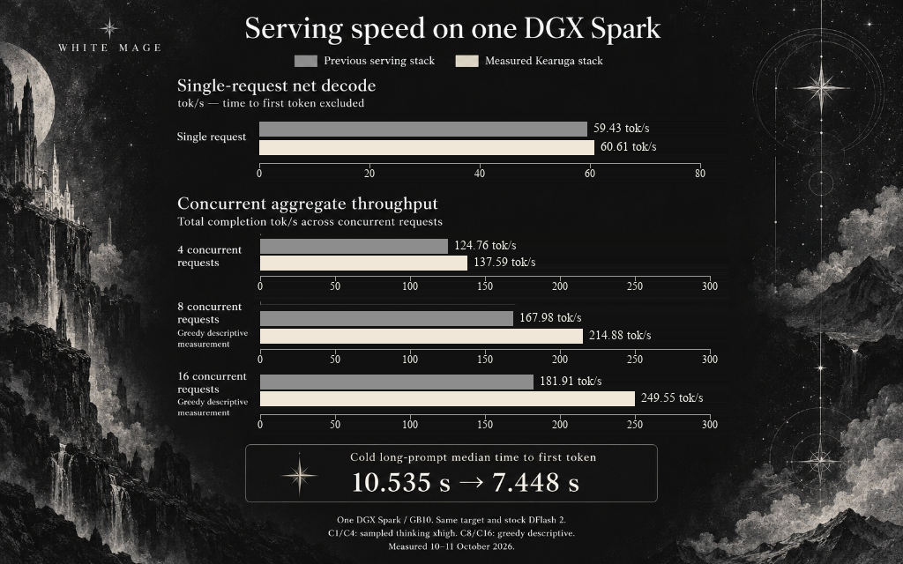
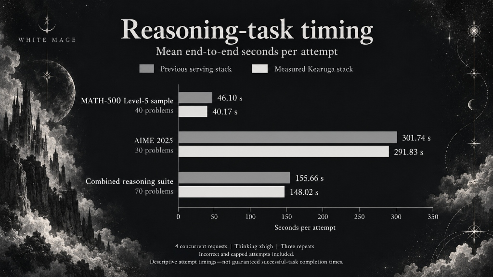

<div align="center">


# ThinkingCap EXL3 · Tandem on DGX Spark & RTX 5090 recipes

**Compact weights. Efficient reasoning. TandemLLM-first Spark serving, independent RTX 5090 receipts, and a retained TensorFold reproduction recipe.**

[](#requirements)
[](#24-gb-nvidia-gpus)
[](#the-stack)
[](docs/TANDEM.md)
[](https://huggingface.co/0xWhiteMage/ThinkingCap-Qwen3.8-27B-Kearuga-EXL3-4.00bpw)
[](https://github.com/0xWhiteMage/thinkingcap-qwen3.8-27b-exl3-tensorfold-cuda/actions/workflows/checks.yml)
[](https://x.com/0xWhiteMage)
[](https://ko-fi.com/0xwhitemage)

[Why this recipe](#why-this-recipe) · [The stack](#the-stack) · [Independent receipts](#independent-rtx-5090-and-spark-receipts) · [Historical results](#measured-results) · [Tandem quick start](#quick-start) · [Recommended recipes](docs/RECOMMENDED-RECIPES.md) · [API](#use-the-api) · [Credits](#credits-and-licences)

</div>

---

Serve **BottleCap AI's ThinkingCap-Qwen3.8-27B**, quantised as the **Kearuga EXL3 4.00bpw release**, through a local OpenAI-compatible endpoint. **TandemLLM is now the primary serving recommendation for DGX Spark / ASUS GX10 (GB10).** The older TensorFold Python CUDA recipe is retained for historical reproduction, not presented as the current default. The repository name remains unchanged so existing links keep working.

> **Keep the stacks separate.** The independent desktop RTX 5090 **32 GB** results use **ExLlamaV3 + MTP**, not Tandem or TensorFold. The **24 GB** route remains experimental. Historical TensorFold throughput, fidelity and task results below have not been re-labelled as Tandem measurements.

| Your hardware | Start here | Current status |
| --- | --- | --- |
| DGX Spark / ASUS GX10, GB10, 128 GB unified memory | **[TandemLLM recipe](docs/TANDEM.md)** | Independent v0.12.0 C1 raw-path receipt; separate resident v0.11.4 smoke/inspection, not a fresh v0.12.0 qualification |
| Desktop RTX 5090 **32 GB** | [Suggested ExLlamaV3 + MTP setup](docs/RECOMMENDED-RECIPES.md#rtx-5090-32-gb--exllamav3--mtp) | Independent batch-one measurement; not a Tandem-on-5090 claim |
| Historical Spark reproduction | [Legacy TensorFold recipe](docs/TENSORFOLD.md) | Original pinned Docker build, manifests, patches and benchmarks retained |
| 24 GB discrete NVIDIA GPUs: RTX 3090 / 4090, RTX 5090 D V2 and RTX 5090 Laptop GPU | [24 GB NVIDIA GPU guide](docs/24GB-GPUS.md) | Experimental one-GPU path; Ampere/Ada EXL3 compilation verified. Blackwell candidates are not yet qualified; SM 12.0 compilation, cold start and fit are unverified |

### Historical TensorFold release at a glance

| Weight storage | Mean KL vs ThinkingCap BF16 | Single-request net decode | 16-request aggregate throughput |
| :---: | :---: | :---: | :---: |
| **16.35 GB** | **0.00517** | **60.61 tok/s** | **249.55 tok/s** |

> **Read these as historical measurements, not installation promises.** The figures are from the release's 10–11 October 2026 qualification. C1 net decode excludes TTFT; C16 is an aggregate greedy descriptive screen, not one person's decode speed. The internal fidelity and task suites are not bundled. See [methodology](docs/BENCHMARKS.md) and the unchanged [source benchmark record](evidence/source/BENCHMARKS.json).

## Why this recipe

- **Keep the reference close.** The release measured 97.7863% top-1 token agreement with ThinkingCap BF16 at teacher-forced positions. That is fidelity, not task accuracy or identical free-running answers.
- **Use Tandem as the current Spark route.** A public community ThinkingCap profile selects the target and Tandem's EXL3 drafters; [the guide](docs/TANDEM.md) pins the engine/installer/profile and explains raw versus conductor serving.
- **Keep historical reproduction possible.** The older Dockerfile/launcher still select TensorFold's pinned Python CUDA stack. They are not silently repurposed to launch Tandem or native TensorFold 1.x.
- **Inspect evidence, not just headline speeds.** Attributed independent JSON receipts, explicit metric definitions and [our actual Spark topology](docs/SPARK-TANDEM.md) let users see what was measured and what was not.
- **Inspect the 24 GB boundary honestly.** A one-lane, no-drafter profile checks real free memory before launch; header estimates and architecture builds are not presented as measured RTX support.

This is a **serving recipe for the published EXL3 weights**, not a new ThinkingCap fine-tune or a BF16-to-EXL3 conversion/calibration recipe.

## The stack

```text
OpenAI-compatible client
        │
        ├── Spark (recommended): TandemLLM → ThinkingCap EXL3 + Tandem EXL3 drafters
        │                         ├── default conductor path (application behaviour)
        │                         └── X-Tandem: raw (plain model measurements)
        ├── RTX 5090 32 GB suggestion: ExLlamaV3 + MTP, int4 KV, batch one
        └── Legacy reproduction: pinned TensorFold Python CUDA + stock DFlash 2
```

| Route | Inputs and settings | Where to inspect |
| --- | --- | --- |
| Public Tandem recipe | v0.12.0 at `f1abbbcf3c4c8e2de6c7d27062ef5b44ca075caf`; community ThinkingCap profile, target HF revision `11447639033dd80a4c04536b5b37ed7d642802ee`; K3 EXL3 drafters + K4 head | [Full recipe](docs/TANDEM.md), [identity manifest](manifests/tandem.json) |
| Our already-resident Spark | v0.11.4, target-path symlink verified by both weight-shard hashes; conductor on, four slots: 262,144 + 3 × 8,192 | [Actual serving analysis](docs/SPARK-TANDEM.md), [sanitised evidence](evidence/tandem-inspection.json) |
| Independent desktop 5090 | ExLlamaV3 1.6.0, MiaAI-Lab kit `bbb11db`, MTP, int4 KV, 262,144 configured context | [Suggested setup and limits](docs/RECOMMENDED-RECIPES.md) |
| Legacy TensorFold | Python CUDA base `ed78d6fc204d89d90b045bf033d6551e7714f3a1`, credited PR #260 rebase + GB10 patch, stock DFlash 2, BF16 KV | [Legacy quick start](docs/TENSORFOLD.md), [provenance](docs/PROVENANCE.md) |

**The public Tandem recipe and our adapted service are not identical.** Stock v0.12.0's launcher does not forward the parallel-slot arguments; our rendered v0.11.4 launcher does. Do not infer four slots from environment values alone, or copy TensorFold's 16-lane settings into Tandem. The [Tandem guide](docs/TANDEM.md#concurrency-a-separate-explicitly-local-adaptation) explains the boundary.

## Independent RTX 5090 and Spark receipts

**Benchmarks by Niklas Lenz** — [GitHub: Nipale-ai](https://github.com/Nipale-ai) · [X: @niklaslenz_ai](https://x.com/niklaslenz_ai) · [niklaslenz.com](https://niklaslenz.com). Thank you, Niklas, for the independent testing and detailed setup notes in [PR #1](https://github.com/0xWhiteMage/thinkingcap-qwen3.8-27b-exl3-tensorfold-cuda/pull/1).

The following are **public C1 probes**, 16 requests each, thinking on, 1,024-token cap, zero request errors. All 11 attached JSONs are retained unchanged and checksum-verified. Hardware, engine/version, clock and setup details are **contributor-reported metadata**, not independently established by those JSONs. These are not a rerun of the historical internal battery.

| Hardware / engine | Cell | Aggregate tok/s | Derived C1 net decode tok/s | Mean TTFT | Cap hits | Receipt |
| --- | --- | ---: | ---: | ---: | ---: | --- |
| RTX 5090 **32 GB**, ExLlamaV3 + MTP | Sampled | 151.10 | 161.74 | 0.092 s | 1 | [JSON](docs/receipts/rtx5090/c1-sampled.json) |
| RTX 5090 **32 GB**, ExLlamaV3 + MTP | Greedy | 164.08 | 178.92 | 0.088 s | 0 | [JSON](docs/receipts/rtx5090/c1-greedy.json) |
| GB10 Spark-class, Tandem v0.12.0 **raw path** | Sampled | 62.22 | 66.02 | 0.158 s | 0 | [JSON](docs/receipts/dgx-spark-tandemllm/sampled-c1-tandem.json) |
| Same GB10 unit, legacy TensorFold | Sampled | 52.43 | 60.16 | 0.506 s | 0 | [JSON](docs/receipts/dgx-spark-tensorfold/sampled-c1.json) |

Aggregate includes full probe wall time; derived C1 net decode is sum(completion tokens) / sum(request wall − TTFT). They are **different metrics**, not interchangeable rates. Hardware, KV, drafters, cache state and generated text differ; this is not an engine ranking. The Spark was capped at 2200 MHz; the 5090 had no clock cap. The 5090 cap-hit request produced no final answer, but its tokens stay in the speed aggregate. Its kit does not report reasoning-token counts, and C4+ was not measured. Tandem's default conductor path was not benchmarked by Niklas.

For the full setups, TensorFold C4/C8/C16 cells, thinking-off speed/quality summaries, limitations and suggestions, see **[recommended recipes](docs/RECOMMENDED-RECIPES.md)**, the [receipt index/checksums](docs/receipts/README.md) and [Niklas's original report](docs/receipts/niklas-pr-1-report.md). Results without attached run files are clearly marked report-only there, rather than promoted as verified headline measurements.

## Measured results

**Historical TensorFold qualification only.** All tables and charts in this section retain the original serving stack and internal-suite scope. They do not qualify Tandem, the RTX 5090 kit or a newly installed runtime.

### Serving throughput

| Workload | Previous TensorFold stack | Qualified stack | Metric |
| --- | ---: | ---: | --- |
| 1 request | 59.43 tok/s | **60.61 tok/s** | Net decode, TTFT excluded |
| 4 concurrent requests | 124.76 tok/s | **137.59 tok/s** | Aggregate completion tokens / cell wall time |
| 8 concurrent requests | 167.98 tok/s | **214.88 tok/s** | Aggregate, greedy descriptive |
| 16 concurrent requests | 181.91 tok/s | **249.55 tok/s** | Aggregate, greedy descriptive |
| Cold long-prompt median TTFT | 10.535 s | **7.448 s** | First-token wait; not sustained decode |



### Fidelity and task timing

| Fidelity measure | EXL3 result | Scope |
| --- | ---: | --- |
| Mean coarsened KL | 0.00517361 | Fixed BF16 top-20 support + other bucket |
| Pooled position p99 KL | 0.06194665 | Tail divergence |
| Top-1 token agreement | 97.7863% | Teacher-forced positions, not task accuracy |
| Tool-domain mean KL | 0.00538761 | Tool slice, not full tool-use certification |
| Maximum position KL | 1.88004674 | Individual positions can differ substantially |

The internal fidelity suite covers **240 prompts and 25,780 positions**. Its reference is ThinkingCap BF16, not base Qwen BF16. KL numbers from other cards are not comparable without matching the reference, support, prompts and method.

| Reasoning workload | Previous mean attempt time | Qualified mean attempt time |
| --- | ---: | ---: |
| MATH-500 Level-5 fixed 40-problem sample | 46.10 s | **40.17 s** |
| AIME 2025, 30 problems | 301.74 s | **291.83 s** |
| Combined 70-problem suite | 155.66 s | **148.02 s** |

Three repeats averaged **62/70 correct**, versus 60/70 previously. The registered quality verdict was **non-inferior**, not general superiority. Wrong and capped attempts remain in the timing averages; current AIME runs reached the cap on 5–6 problems per run. These are measured attempt times, not token-rate estimates or successful-task-only latency.



### ThinkingCap's contribution

BottleCap reports **37.2% fewer reasoning tokens** on a macro-average BF16 evaluation, with 85.8% average accuracy versus base Qwen's 86.6%. Those are [upstream publisher results](https://huggingface.co/bottlecapai/ThinkingCap-Qwen3.8-27B/blob/7891e03dbda2e9b63a5b9610f20e83ea441f8e2c/README.md), not EXL3 measurements; the upstream card may require approved Hugging Face access. This recipe claims no additional thinking-token reduction: the internal 70-problem suite averaged 5,132 reasoning tokens per attempt versus 5,095 previously. Do not multiply an upstream token reduction into the serving-speed improvement.

## Requirements

- **Primary Tandem route:** one NVIDIA DGX Spark / ASUS GX10, GB10, Linux aarch64, 128 GB unified memory, working driver/CUDA compiler. No multi-Spark qualification is claimed.
- **Experimental 24 GB profile:** Linux x86-64 and an Ampere-or-newer discrete NVIDIA GPU. The image build is verified, but card fit and inference are not. See the [startup-admission limitation](docs/24GB-GPUS.md#why-default-startup-is-blocked).
- Tandem's installer manages its Python environment/dependencies; Docker/NVIDIA Container Toolkit are needed only for the legacy TensorFold route. The inspected Spark used driver **580.173.02**, an observation rather than a certified minimum.
- Internet access for pinned source, dependencies and model snapshots. The public community profile needs no HF token unless access restrictions change.
- Read the install/profile download plan. Allow model/dependency/cache space **plus the upstream 60 GB free-disk margin**; do not reduce that guard simply to force an installation.
- GPU capacity available: **do not start a second large engine alongside an existing resident model.** Plan the stop/profile change deliberately; an install dry run is not a deployment authorisation.

The 16.35 GB figure is the two target weight shards, **not total runtime memory**. Drafters, KV, prompt states, workspaces and compilation buffers need additional memory. A configured 262,144-token main window does not imply every concurrent slot has that capacity.

## Quick start

Use the **[TandemLLM Spark recipe](docs/TANDEM.md)** for a new Spark setup. It includes the pinned installer hash, profile inspection, download plan, explicit service-change step, raw/default-path smoke tests, troubleshooting and concurrency caveats. Run it **on an idle Spark**, not on the NAS or beside another resident large model.

### 1. Clone the recipe and inspect the pinned Tandem plan

```bash
git clone https://github.com/0xWhiteMage/thinkingcap-qwen3.8-27b-exl3-tensorfold-cuda.git
cd thinkingcap-qwen3.8-27b-exl3-tensorfold-cuda
git rev-parse HEAD
TANDEM_COMMIT=f1abbbcf3c4c8e2de6c7d27062ef5b44ca075caf
mkdir -p results
curl -fL "https://raw.githubusercontent.com/0xBakeer/TandemLLM/$TANDEM_COMMIT/install.sh" \
  -o results/tandem-install.sh
printf '%s\n' '8907b0ba5786e137be7b2d0628d2141d53f2e55da2ee6b1ddbb1cd0500aaa4f8  results/tandem-install.sh' \
  | sha256sum -c -
bash results/tandem-install.sh --dir "$HOME/TandemLLM" --ref "$TANDEM_COMMIT" \
  --setup --no-start --yes --host 127.0.0.1 --port 8000 --dry-run
```

### 2. Follow the full install/profile/verification steps

Continue in **[docs/TANDEM.md](docs/TANDEM.md#2-install-then-inspect-the-community-profile)**. Do not install over an existing configured directory or manually remove setup/rollback markers. The installer plan was exercised on our GB10; a fresh v0.12.0 install/cold start was not repeated in this documentation pass.

Once the intended community profile is healthy, from this repository:

```bash
python3 scripts/probe.py --endpoint http://127.0.0.1:8000 --model TandemLLM \
  --tandem-raw --thinking off --greedy --max-tokens 64 \
  --output results/tandem-ready.json
python3 scripts/probe.py --endpoint http://127.0.0.1:8000 --model TandemLLM \
  --tandem-raw --thinking on --requests 2 --max-tokens 1024 \
  --output results/tandem-thinking.json
```

Check completed final answers, finish reasons, zero errors and zero cap hits. Repeat without `--tandem-raw` into fresh receipt paths to test the default conductor route separately. These are diagnostics, not a benchmark or task-quality score. Do not expose the unauthenticated endpoint to the internet; use localhost plus an SSH tunnel or authenticated, access-restricted proxy.

For the original pinned download → Docker build → `scripts/serve.py` flow, use **[the legacy TensorFold guide](docs/TENSORFOLD.md)**. The 5090 setup and other suggestions are under **[recommended recipes](docs/RECOMMENDED-RECIPES.md)**.

## 24 GB NVIDIA GPUs

There is a separate x86-64 build and **opt-in `cuda24` profile** for users evaluating 24 GB discrete NVIDIA GPUs. Examples include RTX 3090/4090 and the **RTX 5090 D V2 / RTX 5090 Laptop GPU — 24 GB Blackwell candidates, not yet qualified**. The profile selects one GPU, removes the drafter, uses one lane with at most 8,192 context tokens, keeps BF16 KV/prompt math, and checks the upstream memory plan before starting. Its architecture floor does not exclude Blackwell, but SM 12.0 compilation and real-card startup/inference have not been tested; Spark's SM 12.1 results do not establish RTX 50-series support.

**The limitation is startup, not just context.** Header-derived estimates give 17.085 GiB while serving at 8,192 context, but **21.898 GiB at loading**. TensorFold's default reserve leaves at most 20 GiB on an ideal 24 GiB card, so default admission refuses even a short context. The upstream 2 GiB reserve override needs at least 23.898 GiB truly free after CUDA initialisation—too little spare room to promise a normal desktop card will fit.

```bash
# Target only; do not download or mount a speculative drafter for this profile.
python scripts/artifacts.py --role target
docker build --platform linux/amd64 -t thinkingcap-exl3:0.2.0 .
python scripts/serve.py --profile cuda24 --dry-run
```

The actual attempt requires `--experimental-24gb` and may safely refuse. See the [full 24 GB guide](docs/24GB-GPUS.md) for architecture differences, live preflight, requests without prefix retention, and the evidence needed to qualify a card. **No 24 GB RTX speed or measured-fit claim is made.** The independent **32 GB desktop 5090** result uses a different engine/KV path and does not qualify this profile.

## Use the API

This is the **Spark** API example. The 24 GB guide uses a smaller output default/request budget, serial requests and `"draft": false`; the output default is not a hard per-request ceiling.

This example targets **Tandem's raw model path**. Remove `X-Tandem: raw` for the configured default conductor path; do not combine their timings. Confirm the public model ID with `/v1/models`.

```bash
curl -N http://127.0.0.1:8000/v1/chat/completions \
  -H 'Content-Type: application/json' -H 'X-Tandem: raw' \
  -d '{
    "model": "TandemLLM",
    "messages": [{"role": "user", "content": "Explain Python context managers with a short example."}],
    "stream": true,
    "stream_options": {"include_usage": true},
    "max_tokens": 8192,
    "temperature": 1.0,
    "top_p": 0.95,
    "top_k": 20,
    "chat_template_kwargs": {"enable_thinking": true, "reasoning_effort": "xhigh"}
  }'
```

`max_tokens` includes reasoning and answer: an undersized budget can end before final content. Reasoning format is version/configuration-dependent; our v0.11.4 raw service can return `<think>` tags inline in `content`, while newer Tandem/plain-client behaviour can separate `reasoning_content`. The requested `xhigh` is not proof of the effective conductor policy. Record path, effective effort and format with any result. See [the full Tandem API/verification notes](docs/TANDEM.md).

## Reproducibility boundaries

| What this repository provides | What it does not establish |
| --- | --- |
| Pinned Tandem engine/installer/community entry/target and inspected upstream workflow | A hermetic full auxiliary-asset snapshot, or a fresh maintainer v0.12.0 cold-start qualification |
| Six successful short requests on our resident v0.11.4 service, both paths/thinking modes | Tandem accuracy, sustained concurrency, full-window capacity or a speed ranking |
| Attributed independent RTX 5090 / Spark JSON receipts, unchanged and checksum-verified | Tandem-on-5090 support, 24 GB fit, or reproduction of internal historical suites |
| Immutable target/drafter manifests and checked downloads | A BF16 conversion/calibration dataset or exact re-quantisation procedure |
| Buildable public-source TensorFold Python CUDA stack | Support in native TensorFold 1.x, SGLang or vLLM |
| PR #260 attribution, patch checksums and source-tree check | Kearuga authorship of community kernels |
| Pinned ARM64/AMD64 CUDA base manifests and runtime dependency versions | Byte-identical Docker image IDs or identical timing on all hosts |
| Safe launcher and public API probes | Reproduction of unpublished fidelity prompts/captures or internal Hard-V2-R sampling |
| Fresh ARM64 image build, source comparison and live API receipts | A fresh replacement-server cold start or a rerun of the full benchmark qualification |
| Fresh x86-64 image build and reproducible header-capacity estimates | A measured 24 GB cold start, peak memory, inference pass or RTX benchmark |

The historical **TensorFold** recipe image was built on the Spark. Its **456 installed source/data files matched the then-resident qualified TensorFold runtime after CRLF-to-LF normalisation**; this is source-text equivalence, not raw-byte equality or a Tandem comparison. The new Tandem inspection likewise left the healthy existing service running. See [verification evidence](docs/VERIFICATION.md). No new performance or general-quality claim is made from these small smoke requests.

## Repository map

```text
docs/TANDEM.md             Primary pinned Spark install/profile/API recipe
docs/SPARK-TANDEM.md       Actual resident-service topology and local adaptations
docs/RECOMMENDED-RECIPES.md Hardware-specific suggestions and evidence boundaries
docs/receipts/             Niklas's unchanged JSONs, full report, index and hashes
docs/TENSORFOLD.md         Retained historical quick start
Dockerfile                 Legacy pinned ARM64/AMD64 TensorFold build
requirements-runtime.txt   Legacy TensorFold Python dependency closure
manifests/                 Tandem identity plus legacy target/drafter/runtime manifests
patches/                   Credited PR #260 rebase, GB10 change, checksums
scripts/artifacts.py       Download and verify model files
scripts/serve.py           Legacy TensorFold launcher / experimental cuda24 profile
scripts/capacity_check.py  Exact-runtime header estimates and live admission preflight
scripts/probe.py           Streaming API probe; --tandem-raw sends the raw-path header
scripts/compare_runtime.py Optional source-text comparison with an existing runtime
bench/prompts.json         Small public prompt set, not the historical benchmark suite
assets/                    Release banner and historical charts
evidence/                  Sanitised Tandem inspection plus historical evidence
docs/                      Methodology, provenance, verification, troubleshooting
third_party/tensorfold/    Retained upstream software licence and notices
third_party/thinkingcap/   Unchanged target-release licence bundle and credits
```

## Troubleshooting

For Tandem, start with [the primary guide](docs/TANDEM.md): verify actual model/profile identity, the rendered launcher, raw/conductor path, effort, setup/rollback status and slot windows. For TensorFold image/kernel/admission issues, use [the legacy troubleshooting guide](docs/TROUBLESHOOTING.md) and [container lifecycle notes](docs/TENSORFOLD.md#api-and-lifecycle). **Do not “fix” a failure by loading different weights or a latest engine while retaining the old benchmark claims.** Never use a broad container/cache prune as a startup step.

## Credits and licences

| Creator / contributor | Contribution |
| --- | --- |
| **BottleCap AI** | ThinkingCap fine-tune, source weights, token-efficiency work and governing model licence |
| **Alibaba Cloud / Qwen Team** | Original Qwen model, architecture, tokenizer and Apache-2.0 upstream materials |
| **Turboderp / ExLlamaV3 contributors** | EXL3 format and quantisation tooling |
| **[0xBakeer / TandemLLM contributors](https://github.com/0xBakeer/TandemLLM)** | Current recommended Spark engine, community profiles and Tandem EXL3 drafters |
| **[Niklas Lenz / Nipale-ai](https://github.com/Nipale-ai)** · **[X: @niklaslenz_ai](https://x.com/niklaslenz_ai)** · [niklaslenz.com](https://niklaslenz.com) | Independent RTX 5090 and Spark benchmarks, setup notes and unchanged receipt JSONs in PR #1 |
| **[MiaAI-Lab](https://github.com/MiaAI-Lab/Qwen3.8-27B-16gb-NVIDIA-GPUs-one-click-install)** | ExLlamaV3 + MTP kit used in Niklas's independent RTX 5090 setup |
| **Ash (`ashhart`) / TensorFold contributors** | Serving engine, scheduling, verification and sampling machinery |
| **BHCC2025 / BHCC Spark Lab** | PR #260 EXL3 CUDA contributions used by the qualified runtime |
| **Inco AI; z-lab / Z Lab** | DFlash 2, stock mirror and original DFlash research/architecture |
| **khronnuz** | Community model resources used during preparation/evaluation, not the final direct source weights |
| **0xWhiteMage / Kearuga** | Quantised release, evaluation, serving integration and this recipe |
| **NVIDIA, PyTorch, Triton contributors** | Hardware, CUDA environment and software toolchain |

Required Notice: Copyright 2026 BottleCap AI (https://bottlecapai.com)

Authored recipe scripts and documentation use [MIT](LICENSE). **TandemLLM is separately AGPL-3.0**, not relicensed by this recipe; no Tandem engine source is bundled. Niklas's contribution remains explicitly attributed. Vendored TensorFold changes remain **Apache-2.0**, with [upstream licence and notices retained](third_party/tensorfold/). The weights and reused release materials retain **PolyForm Small Business 1.0.0 plus BottleCap's individual personal, non-commercial-use permission**; the [original licence and permission](third_party/thinkingcap/LICENSE), [full PolyForm terms](third_party/thinkingcap/LICENSE-PolyForm-Small-Business-1.0.0.txt), [Qwen licence](third_party/thinkingcap/LICENSE-Apache-2.0-Qwen.txt), [NOTICE](third_party/thinkingcap/NOTICE) and [attributions](third_party/thinkingcap/ATTRIBUTIONS.md) are included unchanged. Qwen's Apache-2.0 materials do not make the whole derivative Apache-2.0. Commercial use outside the Small Business definition requires separate permission from BottleCap. External drafter/software licences are separate; no weights are redistributed in this Git repository. See [third-party scope](THIRD_PARTY_NOTICES.md).

No contributor endorsement is implied. Please credit ThinkingCap, Qwen, EXL3, TandemLLM, TensorFold, DFlash and Niklas's independent measurements when discussing their respective work.
